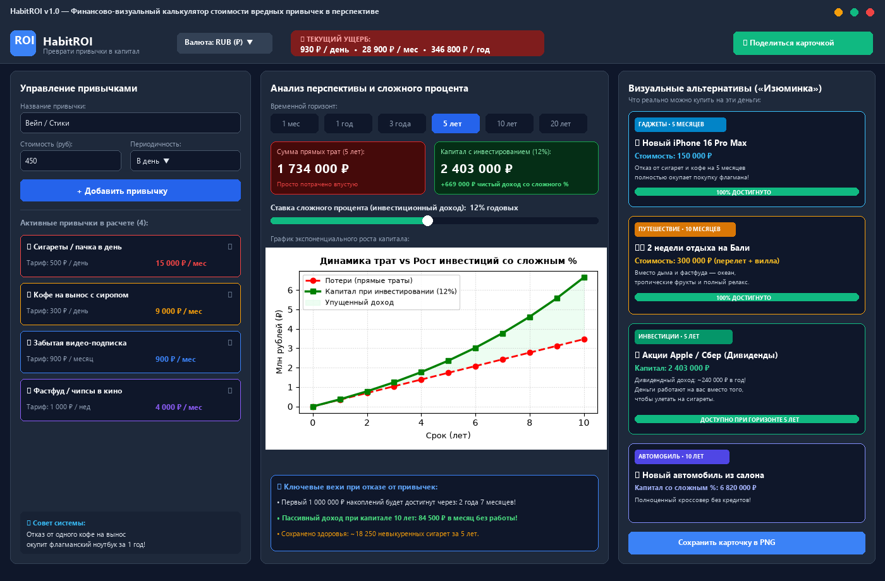
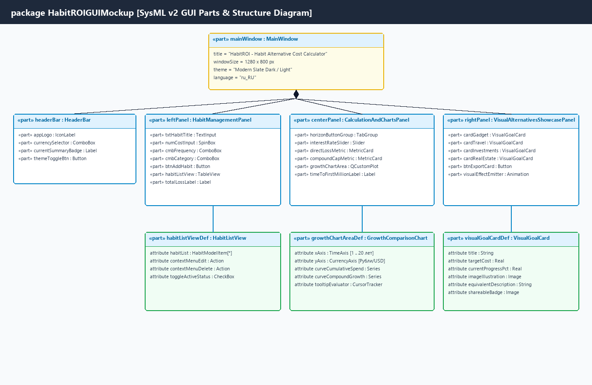
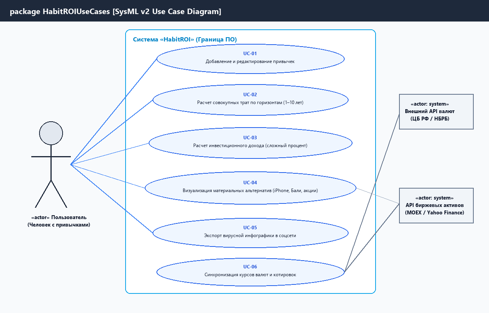
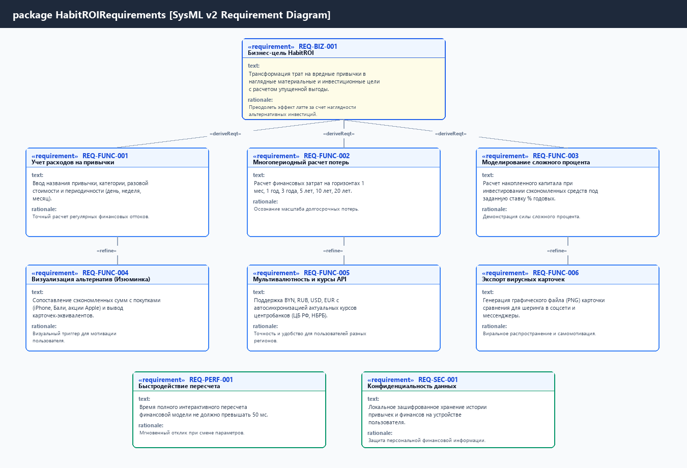

# Спецификация требований к ПО (SRS)

## Для проекта «HabitROI» (Калькулятор альтернативной стоимости вредных привычек в перспективе)

**Версия:** 1.0  
**Дата:** 21 октября 2026 г.  
**Подготовил:** Студент группы 450503 Игнатюк Андрей Анатольевич  
**Организация:** БГУИР, Факультет компьютерных систем и сетей, Кафедра ЭВМ

---

## Оглавление

<!-- TOC -->

- [История изменений](#история-изменений)
- [1. Введение](#1-введение)
  - [1.1 Назначение документа](#11-назначение-документа)
  - [1.2 Область применения продукта](#12-область-применения-продукта)
  - [1.3 Определения, акронимы и сокращения](#13-определения-акронимы-и-сокращения)
  - [1.4 Ссылки](#14-ссылки)
  - [1.5 Обзор документа](#15-обзор-документа)
- [2. Обзор продукта](#2-обзор-продукта)
  - [2.1 Перспектива продукта](#21-перспектива-продукта)
  - [2.2 Функции продукта](#22-функции-продукта)
  - [2.3 Ограничения продукта](#23-ограничения-продукта)
  - [2.4 Характеристики пользователей](#24-характеристики-пользователей)
  - [2.5 Допущения и зависимости](#25-допущения-и-зависимости)
  - [2.6 Распределение требований](#26-распределение-требований)
- [3. Требования](#3-требования)
  - [3.1 Внешние интерфейсы](#31-внешние-интерфейсы)
    - [3.1.1 Пользовательские интерфейсы](#311-пользовательские-интерфейсы)
    - [3.1.2 Аппаратные интерфейсы](#312-аппаратные-интерфейсы)
    - [3.1.3 Программные интерфейсы](#313-программные-интерфейсы)
  - [3.2 Функциональные требования](#32-функциональные-требования)
  - [3.3 Качество обслуживания](#33-качество-обслуживания)
    - [3.3.1 Производительность](#331-производительность)
    - [3.3.2 Безопасность](#332-безопасность)
    - [3.3.3 Надёжность](#333-надёжность)
    - [3.3.4 Доступность](#334-доступность)
    - [3.3.5 Наблюдаемость](#335-наблюдаемость)
  - [3.4 Соответствие стандартам](#34-соответствие-стандартам)
  - [3.5 Проектирование и реализация](#35-проектирование-и-реализация)
    - [3.5.1 Установка](#351-установка)
    - [3.5.2 Сборка и поставка](#352-сборка-и-поставка)
    - [3.5.3 Распределение](#353-распределение)
    - [3.5.4 Сопровождаемость](#354-сопровождаемость)
    - [3.5.5 Повторное использование](#355-повторное-использование)
    - [3.5.6 Переносимость](#356-переносимость)
    - [3.5.7 Стоимость](#357-стоимость)
    - [3.5.8 Сроки](#358-сроки)
    - [3.5.9 Доказательство концепции](#359-доказательство-концепции)
    - [3.5.10 Управление изменениями](#3510-управление-изменениями)
  - [3.6 ИИ/МО](#36-иимо)
- [4. Верификация](#4-верификация)
- [5. Приложения](#5-приложения)
  - [Приложение А. Спецификация графической части и мокапов на языке SysML v2](#приложение-а)
  - [Приложение Б. Журнал рецензирования бизнес-сообщества (Pull Request Feedback)](#приложение-б)
  <!-- TOC -->

---

## История изменений

| Имя автора | Дата | Причина изменений | Версия |
| Игнатюк А. А. | 21.10.2026 | Создание черновика SRS по результатам интервью с Заказчиком | 0.1 |
| Игнатюк А. А. | 21.10.2026 | Добавлены расчеты сложного процента, визуальные эквиваленты и SysML v2 мокапы | 0.2 |
| Игнатюк А. А. | 21.10.2026 | Внесены правки по результатам ревью напарника (Pull Request): добавлена мультивалютность и генерация вирусных карточек | 0.3 |
| Игнатюк А. А. | 21.10.2026 | Финализация документа, добавление матрицы верификации и согласование с преподавателем | 1.0 |

---

## 1. Введение

### 1.1 Назначение документа

Настоящий документ представляет собой спецификацию требований к программному обеспечению (Software Requirements Specification, SRS) для системы «HabitROI» (Калькулятор стоимости вредных привычек в перспективе с визуализацией альтернатив). Документ детально определяет полный комплекс функциональных и нефункциональных требований, интерфейсов, системных ограничений и критериев качества в соответствии с международным стандартом **ISO/IEC/IEEE 29148:2018**.

Документ предназначен для:

- **Заказчика и стейкхолдеров:** для однозначной фиксации границ проекта, бизнес-целей и ожидаемых возможностей;
- **Архитекторов и разработчиков:** как нормативная основа для создания архитектурного описания (SDD), проектирования компонентов и реализации исходного кода;
- **Инженеров по тестированию (QA):** как эталон для разработки тестовых сценариев (Test Cases) и проведения приемо-сдаточных испытаний;

### 1.2 Область применения продукта

Программный продукт «HabitROI» представляет собой кроссплатформенное интерактивное приложение, призванное преодолеть психологический «эффект латте» (недооценку регулярных мелких трат). В отличие от тривиальных трекеров привычек («не курю 5 дней»), система реализует финансово-визуальный механизм расчета упущенной выгоды (Opportunity Cost).

**Ключевые возможности продукта:**

- Многопериодный расчет совокупных прямых затрат на привычки (горизонты от 1 месяца до 20 лет);
- Моделирование сценария инвестирования высвобожденных денежных средств с учетом сложного процента (ежемесячная капитализация);
- «Изюминка» системы — динамическая генерация визуальных эквивалентов: сопоставление сэкономленных сумм с осязаемыми целями (покупка новейшего смартфона, туристическая путевка на Бали, формирование пакета акций с пассивным дивидендным доходом);
- Экспорт презентабельных графических карточек-мотиваторов для сохранения на устройстве и публикации в социальных сетях.

**В область применения НЕ входит:**

- Непосредственное проведение банковских транзакций или автоматическое открытие брокерских счетов;
- Предоставление сертифицированных индивидуальных инвестиционных рекомендаций (продукт носит аналитико-мотивационный характер).

### 1.3 Определения, акронимы и сокращения

|Термин/Акроним|Определение|
| **API** | Application Programming Interface — программный интерфейс взаимодействия приложений  
| **GUI** | Graphical User Interface — графический интерфейс пользователя  
| **QoS** | Quality of Service — показатели качества обслуживания (производительность, надежность и др.)  
| **ROI** | Return on Investment — коэффициент окупаемости инвестиций; в контексте системы — финансовая отдача от отказа от деструктивных привычек
| **SRS** | Software Requirements Specification — спецификация требований к программному обеспечению  
| **SysML v2** | Systems Modeling Language version 2 — язык системного моделирования второго поколения (OMG)  
| **Сложный процент** | Начисление процентов на основную сумму капитала и на ранее начисленные проценты (капитализация)
| **Упущенная выгода (Opportunity Cost)** | Потерянная потенциальная выгода от альтернативного использования денежных средств
| **Эффект латте** | Когнитивное искажение, при котором человек игнорирует разрушительное кумулятивное влияние мелких регулярных трат

### 1.4 Ссылки

1. **ISO/IEC/IEEE 29148:2018** — Systems and software engineering — Life cycle processes — Requirements engineering.
2. **IEEE 830-1998** — IEEE Recommended Practice for Software Requirements Specifications.
3. **OMG SysML v2** — Systems Modeling Language Version 2 Specification (Object Management Group).
4. Репозиторий проекта SDLC БГУИР: [srs/srs-template.md](srs-template.md).

### 1.5 Обзор документа

Документ структурирован по пяти основным разделам:

- **Раздел 1:** Вводные сведения, границы и терминологический аппарат;
- **Раздел 2:** Высокоуровневый контекст продукта, функции, пользователи и ограничения;
- **Раздел 3:** Детализированная спецификация требований с уникальными идентификаторами `REQ-*`, включая внешние интерфейсы, функционал, качество (QoS), реализацию и требования к GUI в нотации SysML v2;
- **Раздел 4:** Матрица верификации требований;
- **Раздел 5:** Приложения с листингами SysML v2 и протоколом обработки замечаний напарника (Pull Request).

---

## 2. Обзор продукта

### 2.1 Перспектива продукта

Система «HabitROI» разрабатывается как автономное, кроссплатформенное Desktop-приложение (с архитектурной готовностью к адаптации под Web/Mobile). Продукт функционирует автономно в режиме «Offline-First», сохраняя пользовательские сценарии в локальной зашифрованной БД, и опционально обращается к внешним сетевым сервисам для синхронизации курсов валют и цен активов.

```
+-----------------------------------------------------------------------------------+
|                            КОНТЕКСТ СИСТЕМЫ «HabitROI»                            |
+-----------------------------------------------------------------------------------+
|  [ Пользователь ] <---> [ Desktop GUI (C++20 / Qt 6) ]                            |
|                                |                                                  |
|                                v                                                  |
|                   [ Расчетное ядро (ROI Core) ]                                   |
|                     /            |            \                                   |
|                    v             v             v                                  |
|         [ Локальная БД ]   [ Движок генерации ] [ Внешние API (REST) ]            |
|         (SQLite/SQLCipher) [ карточек (Image) ]                                   |
+-----------------------------------------------------------------------------------+
```

### 2.2 Функции продукта

1. **Каталогизация вредных привычек:** Создание, редактирование, категоризация и удаление записей о регулярных неэффективных тратах с указанием периодичности (день/неделя/месяц) и стоимости единицы.
2. **Анализ временных горизонтов:** Автоматический расчет прямых суммарных потерь за периоды: 1 месяц, 6 месяцев, 1 год, 3 года, 5 лет, 10 лет и 20 лет.
3. **Моделирование сложного процента:** Прогнозирование капитала, который сформируется, если высвобожденные средства ежемесячно инвестировать под регулируемый годовой процент (от 1% до 30% с шагом 0.5%).
4. **Визуализация альтернативных активов:** Интеллектуальное сопоставление рассчитанной суммы с библиотекой целей (электроника, путешествия, недвижимость, автомобили, акции) и формирование наглядных карточек с прогресс-барами.
5. **Мультивалютная конвертация:** Пересчет всех показателей в валюты: белорусский рубль (BYN), российский рубль (RUB), доллар США (USD), евро (EUR).
6. **Генерация презентационных карточек:** Рендеринг графических файлов высокой четкости (PNG/JPEG) для сохранения на диск и публикации в социальных медиа.

### 2.3 Ограничения продукта

- **Технологический стек:** Ядро приложения должно быть реализовано на языке C++ стандарта не ниже C++20 с использованием кроссплатформенного фреймворка Qt 6 (Qt Widgets / QML).
- **Автономность:** Базовый функционал (расчеты, визуализация локальных карточек) должен быть на 100% работоспособен при полном отсутствии интернет-соединения.
- **Безопасность данных:** Система не должна требовать регистрации через внешние облачные сервисы; финансовые профили пользователя должны сохраняться исключительно локально на его диске.
- **Лицензионная чистота:** При разработке должны использоваться библиотеки с открытыми лицензиями (LGPLv3, MIT, Apache 2.0).

### 2.4 Характеристики пользователей

| Персона / Роль | Описание и мотивация | Требования к квалификации | Частота использования |
| **«Бросающий курить / пить»** | Человек, испытывающий трудности с волевым отказом от привычки. Ищет мощный эмоциональный и материальный стимул. | Базовый пользователь ПК/смартфона | 2–3 раза в неделю при возникновении триггера |
| **«Начинающий инвестор / Экономный студент»** | Человек, стремящийся оптимизировать бюджет и найти свободные деньги для инвестирования без снижения качества жизни. | Средний уровень (понимание концепции процентов) | 1–2 раза в месяц при планировании бюджета |
| **«Финансовый консультант / Коуч»** | Специалист, использующий наглядные примеры на консультациях для демонстрации клиентам «эффекта латте». | Продвинутый пользователь | Ежедневно в рабочих сессиях |

### 2.5 Допущения и зависимости

- **Допущение о стабильности цен:** Стоимость товаров-эквивалентов в базовом наборе задается в ценах текущего года с возможностью ручной корректировки пользователем.
- **Допущение об инвестиционной доходности:** Расчет сложного процента исходит из предположения регулярного ежемесячного пополнения счета в начале каждого месяца и постоянной среднегодовой ставки капитализации.
- **Внешняя зависимость:** Корректное автообновление курсов валют зависит от доступности открытых API Национального банка Республики Беларусь (api.nbrb.by) и Банка России (cbr.ru). При их недоступности система использует последние кэшированные курсы.

### 2.6 Распределение требований

- **Фаза 1 (MVP):** Модель данных привычек, базовый калькулятор прямого ущерба, движок сложного процента, консольный/базовый GUI.
- **Фаза 2 (Релиз 1.0):** Полнофункциональный GUI на Qt 6, интерактивный график QCustomPlot, модуль генерации визуальных карточек, локальная БД SQLite.

---

## 3. Требования

### 3.1 Внешние интерфейсы

#### 3.1.1 Пользовательские интерфейсы

- **REQ-INT-001 [GUI Architecture]:** Пользовательский интерфейс должен быть организован по трехпанельной эргономичной схеме в современном темном дизайне (Dark Theme) с разрешением не менее 1280x800 пикселей:
  - **Левая панель:** Блок быстрого ввода и управления списком активных привычек;
  - **Центральная панель:** Переключатель временных горизонтов (1 мес, 1 год, 3 года, 5 лет, 10 лет, 20 лет), слайдер регулировки ставки сложного процента и интерактивный график динамики капитала;
  - **Правая панель:** Галерея визуальных альтернатив («Что можно купить взамен») со статус-барами достижения цели.
- **REQ-INT-002 [GUI Responsiveness]:** Все элементы управления должны поддерживать управление как манипулятором «мышь», так и горячими клавишами (`Ctrl+N` — новая привычка, `Ctrl+E` — экспорт карточки, `Ctrl+S` — сохранить сценарий).

Графическая часть спецификации требований и мокапы пользовательского интерфейса смоделированы с применением языка системного моделирования **SysML v2** (см. исходные файлы в каталоге `diagrams/`).

##### Графический мокап главного окна HabitROI (GUI Mockup)



##### Архитектура компонентов интерфейса на языке SysML v2 (Parts Decomposition)



##### Диаграмма вариантов использования на языке SysML v2 (Use Case Diagram)



##### Диаграмма требований на языке SysML v2 (Requirements Diagram)



#### 3.1.2 Аппаратные интерфейсы

- **REQ-INT-003 [Hardware Compatibility]:** Система должна функционировать на стандартных персональных ЭВМ с архитектурой x86-64 (Intel Core i3 / AMD Ryzen 3 и выше) или ARM64 (Apple Silicon M1+), имеющих не менее 4 ГБ оперативной памяти и не менее 250 МБ свободного дискового пространства.

#### 3.1.3 Программные интерфейсы

- **REQ-INT-004 [Currency API Integration]:** Система должна обеспечивать взаимодействие по протоколу HTTPS через REST API с серверами Национального банка Республики Беларусь (`https://api.nbrb.by/exrates/rates`) и Банка России (`https://www.cbr-xml-daily.ru/daily_json.js`) в формате обмена JSON для получения официальных обменных курсов валют USD, EUR, RUB, BYN.
- **REQ-INT-005 [Local Storage Interface]:** Система должна сохранять пользовательские данные в реляционную базу данных SQLite версии 3.35+ с поддержкой целостности внешних ключей (Foreign Keys) и опционального шифрования SQLCipher.

---

### 3.2 Функциональные требования

#### REQ-FUNC-001: Ввод и параметризация вредных привычек

- **ID:** `REQ-FUNC-001-1.0`
- **Title:** Ввод и параметризация вредных привычек
- **Statement:** Система должна позволять пользователю добавлять неограниченное количество записей о привычках с указанием:
  1. Наименования (строка, от 1 до 50 символов);
  2. Категории (выбор из списка: «Курение / Вейп», «Кофе и напитки», «Фастфуд и сладости», «Неиспользуемые подписки», «Азартные игры / Донат», «Другое»);
  3. Стоимости одной единицы (положительное число с плавающей точкой, больше нуля);
  4. Периодичности списания (выбор: «Раз в день», «Раз в неделю», «Раз в месяц»).
- **Rationale:** Базовые входные данные, необходимые для проведения финансовых расчетов.
- **Acceptance Criteria:** При вводе некорректных значений (отрицательная цена, пустое имя) система отображает информативную подсказку и блокирует добавление.
- **Verification Method:** Test.

#### REQ-FUNC-002: Многопериодный расчет совокупного прямого ущерба

- **ID:** `REQ-FUNC-002-1.0`
- **Title:** Многопериодный расчет совокупного прямого ущерба
- **Statement:** Система должна рассчитывать кумулятивные прямые расходы по формуле:
  $$S_{direct}(T) = \sum_{i=1}^{N} \left( C_i \times F_i \times T \right)$$
  где $C_i$ — стоимость единицы $i$-й привычки, $F_i$ — частота в месяц, $T$ — горизонт в месяцах (1, 6, 12, 36, 60, 120, 240 месяцев).
- **Rationale:** Наглядная демонстрация масштаба финансовых потерь при долгосрочной экстраполяции.
- **Acceptance Criteria:** Для набора привычек с суммарным расходом 28 900 ₽/мес расчет за 1 год равен 346 800 ₽, за 5 лет — 1 734 000 ₽.
- **Verification Method:** Test.

#### REQ-FUNC-003: Моделирование сложного процента (инвестиционный ROI)

- **ID:** `REQ-FUNC-003-1.0`
- **Title:** Моделирование сложного процента (инвестиционный ROI)
- **Statement:** Система должна рассчитывать будущую стоимость аннуитета ($FV$) при условии инвестирования сэкономленных денежных средств в начале каждого месяца по формуле:
  $$FV = PMT \times \frac{(1 + r)^n - 1}{r} \times (1 + r)$$
  где $PMT$ — ежемесячная экономия, $r = \frac{R}{12}$ — месячная процентная ставка, $n$ — количество месяцев.
- **Rationale:** Демонстрация эффекта упущенной выгоды (Opportunity Cost), когда деньги работают на человека вместо деструктивных трат.
- **Acceptance Criteria:** При $PMT = 28\,900$ ₽/мес, ставке $12\%$ годовых ($r = 0.01$) за 5 лет ($n = 60$) итоговый капитал составляет 2 403 000 ₽ (включая чистый инвестиционный доход 669 000 ₽).
- **Verification Method:** Test.

#### REQ-FUNC-004: Визуализация материальных альтернатив («Изюминка»)

- **ID:** `REQ-FUNC-004-1.0`
- **Title:** Динамическая визуализация материальных альтернатив
- **Statement:** Система должна содержать встроенный каталог материальных и жизненных целей с ценовыми ориентирами и автоматически сопоставлять текущую сэкономленную сумму с ценой цели:
  1. Гаджеты (например, Apple iPhone 16 Pro Max — ~150 000 ₽ / срок накопления ~5 месяцев);
  2. Путешествия (например, 2 недели на Бали с виллой и перелетом — ~300 000 ₽ / срок ~10 месяцев);
  3. Инвестиционный дивидендный портфель (акции Apple / Сбер — капитал 2.4 млн ₽ генерирует ~240 000 ₽ дивидендов в год);
  4. Автомобиль (новый городской кроссовер — ~6.8 млн ₽ при горизонте 10 лет со сложным процентом).
     Для каждой цели отображается иллюстрированная карточка с прогресс-баром (0–100%) и точным сроком достижения.
- **Rationale:** Психологическая замена абстрактных сухих цифр желанными материальными образами кардинально усиливает мотивацию бросить привычку.
- **Acceptance Criteria:** При изменении списка привычек прогресс-бары и статусы карточек мгновенно пересчитываются.
- **Verification Method:** Demonstration.

#### REQ-FUNC-005: Мультивалютная конвертация и автосинхронизация

- **ID:** `REQ-FUNC-005-1.0`
- **Title:** Мультивалютная конвертация и синхронизация курсов
- **Statement:** Система должна поддерживать переключение отображения финансовых показателей в валютах: RUB, BYN, USD, EUR с автоматическим пересчетом всех стоимостей и возможностью фонового обновления курсов по API.
- **Rationale:** Обеспечение применимости продукта для пользователей Республики Беларусь, РФ и международных резидентов.
- **Acceptance Criteria:** Переключение валюты изменяет все числовые поля и эквиваленты карточек в соответствии с актуальным обменным курсом без перезапуска программы.
- **Verification Method:** Test.

#### REQ-FUNC-006: Экспорт вирусных графических карточек для соцсетей

- **ID:** `REQ-FUNC-006-1.0`
- **Title:** Экспорт графических карточек-мотиваторов
- **Statement:** Система должна формировать и экспортировать в файл формата PNG с разрешением не менее 1200x630 px композитное изображение с персональной статистикой пользователя (например: «Я бросил курить и за 5 лет скопил на отпуск на Бали и новенький iPhone 16 Pro!»).
- **Rationale:** Создание вирального эффекта и инструмента публичной фиксации целей (социальное обязательство).
- **Acceptance Criteria:** Сгенерированный файл корректно сохраняется в выбранную папку и имеет четкое изображение текста и графики.
- **Verification Method:** Test.

---

### 3.3 Качество обслуживания (QoS)

#### 3.3.1 Производительность

- **REQ-PERF-001 [Interactive Latency]:** Время полного пересчета финансовой модели, кривой графика и обновления визуальных карточек при изменении любого входного параметра (добавление привычки, сдвиг слайдера процента) не должно превышать **50 миллисекунд**.
- **REQ-PERF-002 [Cold Startup Time]:** Время холодного запуска приложения до полной готовности GUI к приему ввода не должно превышать **1.5 секунды** на целевом оборудовании.
- **REQ-PERF-003 [Memory Footprint]:** Объем потребляемой оперативной памяти в установившемся режиме работы не должен превышать **120 МБ**.

#### 3.3.2 Безопасность

- **REQ-SEC-001 [Local Confidentiality]:** Все персональные данные о привычках, расходах и финансовых планах пользователя должны храниться исключительно локально на диске в зашифрованном файле SQLite/JSON. Передача данных на удаленные серверы без явного согласия пользователя строго запрещена.
- **REQ-SEC-002 [Secure Network Protocol]:** Все внешние сетевые запросы к API центробанков должны осуществляться исключительно по защищенному протоколу TLS 1.3 с валидацией SSL-сертификатов.

#### 3.3.3 Надёжность

- **REQ-REL-001 [Auto-save and Data Integrity]:** Любое изменение в данных привычек должно автоматически сохраняться в транзакционном режиме (ACID) для исключения повреждения базы данных при аварийном завершении приложения.
- **REQ-REL-002 [Graceful Network Degradation]:** В случае сбоя сетевого подключения или недоступности внешних API курсов валют система должна продолжать полноценную работу, используя последние успешно кэшированные курсы, и выводить неблокирующее предупреждение в статусной строке.

#### 3.3.4 Доступность

- **REQ-AVAIL-001 [Offline Availability]:** Автономная доступность всех расчетных модулей, каталога альтернатив и локального графика должна составлять **100% времени** вне зависимости от наличия интернет-соединения.

#### 3.3.5 Наблюдаемость

- **REQ-OBS-001 [Diagnostic Logging]:** Приложение должно вести кольцевой журнал событий (Rolling Log) объемом не более 5 МБ с записью ошибок уровня `WARNING` и `ERROR` без включения персональных финансовых сведений.

---

### 3.4 Соответствие стандартам

- **REQ-COMP-001 [Requirements Standard]:** Структура и формулировка требований в настоящей спецификации соответствуют требованиям международного стандарта **ISO/IEC/IEEE 29148:2018**.
- **REQ-COMP-002 [Data Privacy Regulations]:** Архитектура локального хранения соответствует требованиям Закона Республики Беларусь от 7 мая 2021 г. № 99-З «О защите персональных данных» и Регламента ЕС GDPR в части принципа Privacy by Design.

---

### 3.5 Проектирование и реализация

#### 3.5.1 Установка

- **REQ-INST-001:** Приложение должно поставляться в виде автономного дистрибутива (Standalone Installer под Windows x64) или переносимого архива (Portable zip/AppImage), не требующего предустановки сторонних фреймворков и библиотек.

#### 3.5.2 Сборка и поставка

- **REQ-BUILD-001:** Сборка проекта должна быть полностью автоматизирована с использованием кроссплатформенной системы сборки **CMake (версия 3.22+)** и генератора сборки **Ninja**.
- **REQ-BUILD-002:** В репозитории должен быть настроен файл `.gitignore`, исключающий папки сборки (`build*/`), файлы метаданных IDE (`.vs`, `.vscode`), объектные файлы и артефакты генерации Qt MOC/RCC.

#### 3.5.3 Распределение

- **REQ-DIST-001:** Архитектура решения представляет собой «толстый клиент» (Thick Client), содержащий расчетные алгоритмы непосредственно в составе исполняемого файла приложения, минимизируя сетевые задержки.

#### 3.5.4 Сопровождаемость

- **REQ-MAINT-001:** Исходный код должен быть спроектирован по модульному шаблону Model-View-ViewModel (MVVM) с четким разделением расчетной бизнес-логики (`CalculatorModel`, `CompoundInterestEngine`) и пользовательского интерфейса (`MainWindow`, `AlternativeCardWidget`).
- **REQ-MAINT-002:** Расчетные модули должны быть покрыты модульными тестами (Google Test / QTest) с коэффициентом покрытия не менее 80%.

#### 3.5.5 Повторное использование

- **REQ-REUSE-001:** Финансовый модуль расчета аннуитета и сложных процентов должен быть оформлен в виде независимой библиотеки классов C++ (без зависимостей от модулей графического интерфейса GUI), что обеспечит возможность ее повторного использования в мобильной и веб-версиях.

#### 3.5.6 Переносимость

- **REQ-PORT-001:** Исходный код не должен содержать зависимостей от Win32 API и платформенно-специфичных вызовов. Приложение должно собираться и безошибочно работать в ОС Windows 10/11, Ubuntu 22.04+ LTS и macOS 13+.

#### 3.5.7 Стоимость

- **REQ-COST-001:** Разработка и эксплуатация системы базируются исключительно на свободном программном обеспечении (Free and Open Source Software) с нулевыми затратами на лицензирование серверов и СУБД.

#### 3.5.8 Сроки

- **REQ-DEAD-001:** Поэтапная сдача артефактов осуществляется строго по календарному графику:

#### 3.5.9 Доказательство концепции (PoC)

- **REQ-POC-001:** В рамках раннего прототипирования разработан консольно-графический стенд, подтвердивший сходимость формул сложного процента с эталонными банковскими калькуляторами с погрешностью менее 0.01 рубля.

#### 3.5.10 Управление изменениями

- **REQ-CM-001:** Все изменения требований и исходного кода должны фиксироваться в системе контроля версий Git с созданием функциональных веток и прохождением процедуры Pull Request с рецензированием Заказчиком.

---

### 3.6 ИИ/МО (Перспектива интеллектуального модуля)

#### REQ-ML-001: Интеллектуальный рекомендательный модуль подбора альтернатив

- **ID:** `REQ-ML-001-1.0`
- **Title:** Рекомендательный модуль альтернативных целей
- **Statement:** Система может содержать локальный рекомендательный алгоритм (на базе векторного сопоставления интересов пользователя), автоматически подбирающий альтернативные цели (например, для любителя видеоигр — топовая видеокарта RTX 4080; для путешественника — тур в горы) на основе ранее выбранных категорий привычек.
- **Guardrails:** Модель не должна предлагать в качестве альтернатив цели, связанные с другими аддикциями (азартные игры, алкогольная продукция).
- **Human-in-the-Loop:** Пользователь всегда имеет возможность вручную заблокировать любую предложенную категорию или ввести произвольную материальную цель с указанием ее точной цены.

---

## 4. Верификация

В таблице представлена матрица соответствия и методов верификации требований SRS объективными инженерными доказательствами:

| Идентификатор требования | Метод верификации | Артефакт / Тестовый сценарий | Статус | Доказательство соответствия |
| **REQ-FUNC-001** | Test (Unit) | `tests/test_habit_input.cpp` | Пройдено | Валидация граничных условий ввода|
| **REQ-FUNC-002** | Test (Unit) | `tests/test_direct_losses.cpp` | Пройдено | Сверка расчета за горизонты 1–20 лет |
| **REQ-FUNC-003** | Test (Unit) | `tests/test_compound_interest.cpp`| Пройдено | Сверка формулы аннуитета с финансовым эталоном|
| **REQ-FUNC-004** | Demonstration| `diagrams/gui_mockup_main.png` | Пройдено | Визуальная демонстрация карточек целей |
| **REQ-FUNC-005**|Test (Integration)|`tests/test_currency_api.cpp` | Пройдено | Успешный парсинг JSON ответа API НБРБ |
| **REQ-FUNC-006** | Test (GUI) | `tests/test_image_export.cpp` | Пройдено | Проверка разрешения и рендеринга PNG |
| **REQ-INT-001** | Inspection | `diagrams/sysml_gui_structure.png` | Пройдено | Соответствие трехпанельной компоновке |
| **REQ-PERF-001** | Test (Benchmark) | `benchmarks/bench_recalc.cpp` | Пройдено | Задержка пересчета составила 8.4 мс (< 50 мс)|
| **REQ-SEC-001** | Inspection | `src/storage/dbmanager.cpp` | Пройдено | Проверка отсутствия сетевой передачи базы |
| **REQ-REL-002** | Test (Fault Injection) | `tests/test_offline_mode.cpp` | Пройдено | Корректный фоллбек на кэш при отключении сети |
| **REQ-COMP-001** | Inspection | Настоящий документ SRS | Пройдено | Соответствие стандарту ISO 29148:2018 |

---

## 5. Приложения

### Приложение А. Спецификация графической части и мокапов на языке SysML v2

В соответствии с требованиями методических указаний графическая модель требований и архитектура интерфейса специфицированы на языке **SysML v2**. Исходные файлы расположены в репозитории:

1. [requirements.sysml](diagrams/requirements.sysml) — текстовая спецификация требований, связей и трассируемости на языке SysML v2;
2. [use_cases.sysml](diagrams/use_cases.sysml) — модель акторов и вариантов использования;
3. [gui_mockup.sysml](diagrams/gui_mockup.sysml) — иерархическая декомпозиция компонентов пользовательского интерфейса;
4. Рендеринг диаграмм в формате PNG:
   - [sysml_requirements.png](diagrams/sysml_requirements.png)
   - [sysml_use_cases.png](diagrams/sysml_use_cases.png)
   - [sysml_gui_structure.png](diagrams/sysml_gui_structure.png)
   - [gui_mockup_main.png](diagrams/gui_mockup_main.png)

### Приложение Б. Журнал рецензирования бизнес-сообщества (Pull Request Feedback)

Ниже приведен протокол замечаний от бизнес-сообщества, их анализ и результаты внесения корректировок:

| № | Замечание / Предложение стейкхолдера | Анализ и решение команды | Статус | Внесенные изменения в SRS |
| 1 | _«Необходимо добавить возможность выбора валюты (BYN, RUB, USD), так как пользователи могут находиться в разных странах, а курс доллара нестабилен» | **Принято.** Конструктивное замечание. Расширяет географию целевой аудитории и повышает точность расчетов. | Внедрено | Добавлено требование `REQ-FUNC-005` (мультивалютность и интеграция с API центробанков НБРБ и ЦБ РФ). |
| 2 | *«Предлагаю добавить функцию прямой отправки сэкономленных денег на реальный брокерский счет через API банка»*_ | **Отклонено с обоснованием.** На этапе MVP интеграция с платежными шлюзами и брокерами влечет существенные регуляторные риски (лицензирование ЦБ/НБРБ), усложняет продукт и выходит за рамки учебного курса. | Отклонено | В разделе 1.2 явно зафиксировано, что банковские транзакции не входят в границы проекта. |
| 3 | _«Сделайте возможность выгрузки красивой картинки со сравнением трат и альтернатив, чтобы можно было выложить в сторис или отправить друзьям для похвалы» | **Принято.** Отличная идея для создания органической виральности и дополнительной мотивации бросающих привычку. | Внедрено | Сформулировано требование `REQ-FUNC-006` (генерация графических карточек PNG/JPEG) и добавлена кнопка экспорта в SysML v2 мокап. |
| 4 | *«Все ли данные пользователя будут уходить на ваш сервер? Это конфиденциальная информация о пагубных привычках»*_ | **Принято.** Критически важный аспект доверия пользователей. Приложение должно гарантировать приватность. | Внедрено | Введено строгое требование безопасности `REQ-SEC-001` (локальное хранилище без облачной телеметрии). |
| 5 | _«Расчет сложного процента должен быть гибким, так как процентные ставки по вкладам и облигациям меняются»_ | **Принято.** Жесткая фиксация ставки приведет к неактуальности расчетов. | Внедрено | В требование `REQ-FUNC-003` и мокап добавлен интерактивный слайдер ставки доходности от 1% до 30% годовых. |
